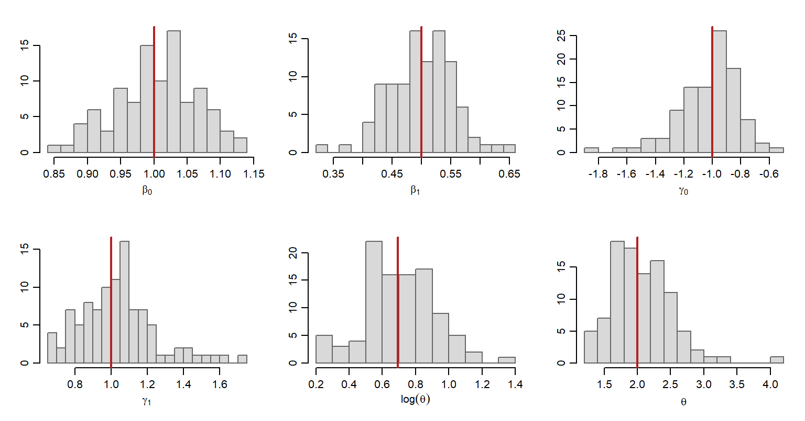
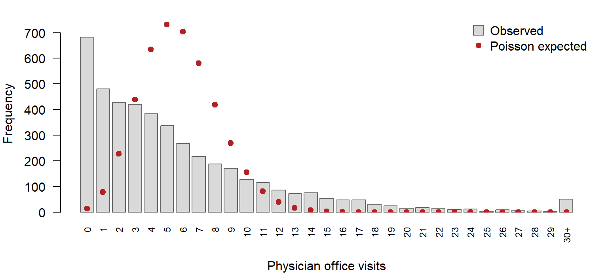
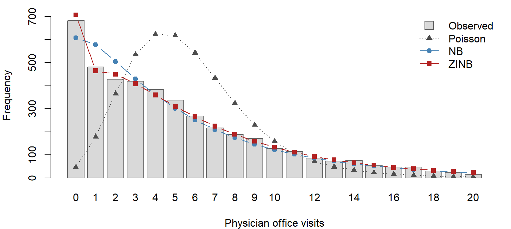

# Negative Binomial and Zero-Inflated Negative Binomial Regression by IRLS and EM

## 1 Introduction

Count outcomes such as the number of doctor visits, published articles,
or insurance claims are usually modeled first with Poisson regression.
The Poisson model forces the variance to equal the mean. Real counts
often vary much more than that (*overdispersion*), and many data sets
contain more zeros than a Poisson distribution with the same mean would
produce (*excess zeros*). If we ignore overdispersion, the coefficient
estimates stay consistent but the standard errors are too small. If we
ignore excess zeros, the model describes the zeros poorly and can mix up
two different processes: whether an event happens at all, and how often
it happens ([Cameron and Trivedi 2013](#ref-cameron2013); [Zeileis et
al. 2008](#ref-zeileis2008)).

Two standard extensions handle these features. The negative binomial
(NB2) model adds a dispersion parameter $`\theta`$, so that
$`\operatorname{Var}(Y) = \mu + \mu^2/\theta`$. The zero-inflated
negative binomial (ZINB) model ([Lambert 1992](#ref-lambert1992))
combines a point mass at zero (“structural zeros”) with an NB count
distribution. In R, these models are usually fitted with
[`MASS::glm.nb()`](https://rdrr.io/pkg/MASS/man/glm.nb.html) ([Venables
and Ripley 2002](#ref-venables2002)) and
[`pscl::zeroinfl()`](https://rdrr.io/pkg/pscl/man/zeroinfl.html)
([Zeileis et al. 2008](#ref-zeileis2008)). The second of these maximizes
the likelihood with the general-purpose optimizer
[`optim()`](https://rdrr.io/r/stats/optim.html).

The goal of this project was to build an R package, **nbzinbWebster**,
that fits both models *with algorithms written from scratch*:

- NB regression by IRLS for $`\beta`$ alternated with Newton–Raphson for
  $`\log\theta`$;
- ZINB regression by the EM algorithm ([Dempster et al.
  1977](#ref-dempster1977)), whose M-steps are a weighted logistic IRLS
  fit and a weighted NB fit;
- no calls to [`optim()`](https://rdrr.io/r/stats/optim.html),
  [`nlm()`](https://rdrr.io/r/stats/nlm.html),
  [`glm()`](https://rdrr.io/r/stats/glm.html),
  [`lm()`](https://rdrr.io/r/stats/lm.html), or any other optimizer or
  model-fitting routine in the fitting code.

The rest of the report describes the methods (Section 2) and the package
(Section 3). It then checks the package against the reference
implementations (Section 4), evaluates
[`zinbreg()`](https://webfam564.github.io/nbzinbWebster/reference/zinbreg.md)
by simulation (Section 5), and analyzes physician office visits in the
NMES1988 data (Section 6).

## 2 Methods

### 2.1 The negative binomial model

Let $`Y_i`$ be a count with covariate vector $`x_i \in \mathbb{R}^p`$,
$`i = 1, \dots, n`$. The NB2 model is

``` math
P(Y_i = y) = \frac{\Gamma(y+\theta)}{\Gamma(\theta)\, y!}
  \left(\frac{\theta}{\theta+\mu_i}\right)^{\theta}
  \left(\frac{\mu_i}{\theta+\mu_i}\right)^{y},
  \qquad y = 0, 1, 2, \dots
 \qquad(1)
```

with log link $`\log\mu_i = \eta_i = x_i^\top\beta + o_i`$, where
$`o_i`$ is an optional offset. Then $`E(Y_i) = \mu_i`$ and
$`\operatorname{Var}(Y_i) = \mu_i + \mu_i^2/\theta`$. As
$`\theta \to \infty`$ the model reduces to the Poisson. With prior
weights $`a_i`$ (all equal to 1 in an ordinary fit) the log-likelihood
is

``` math
\ell(\beta,\theta) = \sum_{i=1}^n a_i \Big[\log\Gamma(y_i+\theta)
  - \log\Gamma(\theta) - \log y_i! + \theta\log\theta + y_i\log\mu_i
  - (\theta+y_i)\log(\theta+\mu_i)\Big].
 \qquad(2)
```

### 2.2 NB fitting: IRLS alternated with Newton–Raphson

**IRLS for $`\beta`$ with $`\theta`$ fixed.** With $`\theta`$ held
fixed, the NB2 model is a GLM with log link and variance function
$`V(\mu) = \mu+\mu^2/\theta`$([McCullagh and Nelder
1989](#ref-mccullagh1989)). The log link is not the canonical link for
this variance, but Fisher scoring is still equivalent to repeated
weighted least squares with working weights and working response

``` math
w_i = a_i\frac{(\partial\mu_i/\partial\eta_i)^2}{V(\mu_i)}
    = a_i\frac{\theta\mu_i}{\theta+\mu_i}, \qquad
z_i = (\eta_i - o_i) + \frac{y_i-\mu_i}{\mu_i},
 \qquad(3)
```

``` math
\beta^{(t+1)} = (X^\top W X)^{-1} X^\top W z, \qquad
W = \operatorname{diag}(w_1,\dots,w_n).
 \qquad(4)
```

The linear system in [Equation 4](#eq-irls) is solved with
[`solve()`](https://rdrr.io/r/base/solve.html). If a step lowers the
log-likelihood, it is halved, which happens rarely. The IRLS loop stops
when the relative change in $`\ell`$ drops below $`10^{-10}`$.

**Newton–Raphson for $`\theta`$ with $`\beta`$ fixed.** The score and
second derivative of [Equation 2](#eq-nb-ll) with respect to $`\theta`$
are

``` math
U(\theta) = \sum_i a_i\Big[\psi(y_i+\theta) - \psi(\theta) + \log\theta + 1
  - \log(\theta+\mu_i) - \frac{y_i+\theta}{\theta+\mu_i}\Big],
 \qquad(5)
```

``` math
H(\theta) = \sum_i a_i\Big[\psi'(y_i+\theta) - \psi'(\theta) + \frac1\theta
  - \frac{2}{\theta+\mu_i} + \frac{y_i+\theta}{(\theta+\mu_i)^2}\Big],
 \qquad(6)
```

where $`\psi`$ and $`\psi'`$ are the digamma and trigamma functions. To
keep $`\theta > 0`$, we update $`\phi = \log\theta`$ instead. The chain
rule gives $`U_\phi = \theta U(\theta)`$ and
$`H_\phi = \theta^2 H(\theta) + \theta
U(\theta)`$, and the update is

``` math
\phi \leftarrow \phi - U_\phi / H_\phi .
 \qquad(7)
```

The step is also halved if it would lower $`\ell`$, and $`\theta`$ is
capped at $`10^8`$ to handle the Poisson limit.

**Outer loop and starting values.** The starting value for $`\beta`$
comes from a Poisson fit computed by the same IRLS code with
$`\theta = \infty`$ (so $`w_i = a_i\mu_i`$). The starting value for
$`\theta`$ is the moment estimate
$`\sum a_i\mu_i^2 / \sum a_i\{(y_i-\mu_i)^2-\mu_i\}`$. The algorithm
then alternates [Equation 4](#eq-irls) and [Equation 7](#eq-nr) until
$`\ell`$ changes by less than $`10^{-8}`$. A final IRLS pass at the
final $`\hat\theta`$ makes $`\hat\beta`$ the maximizer for the
$`\theta`$ that is reported.

**Standard errors.** Like `glm.nb()`, we treat $`\theta`$ as known when
computing the covariance of $`\hat\beta`$. This gives
$`\widehat{\operatorname{Var}}(\hat\beta) = (X^\top\hat W X)^{-1}`$ and
$`\operatorname{SE}(\hat\theta) = \{-H(\hat\theta)\}^{-1/2}`$. The
standard error of $`\log\hat\theta`$ follows by the delta method.

### 2.3 The zero-inflated negative binomial model

With probability $`\pi_i`$ observation $`i`$ is a structural zero. With
probability $`1-\pi_i`$ it is drawn from NB$`(\mu_i,\theta)`$, which can
also produce zeros:

``` math
P(Y_i=0) = \pi_i + (1-\pi_i) f_{NB}(0;\mu_i,\theta), \qquad
P(Y_i=y) = (1-\pi_i) f_{NB}(y;\mu_i,\theta),\ y\ge 1,
 \qquad(8)
```

where $`f_{NB}(0;\mu,\theta) = \{\theta/(\theta+\mu)\}^\theta`$,
$`\log\mu_i = x_i^\top\beta + o_i`$, and
$`\operatorname{logit}\pi_i = z_i^\top\gamma`$. The marginal mean is
$`E(Y_i) = (1-\pi_i)\mu_i`$. The observed-data log-likelihood is

``` math
\ell(\beta,\gamma,\theta) = \sum_{i:\,y_i=0}\log\big[\pi_i
  + (1-\pi_i)f_{NB}(0;\mu_i,\theta)\big]
  + \sum_{i:\,y_i>0}\big[\log(1-\pi_i) + \log f_{NB}(y_i;\mu_i,\theta)\big].
 \qquad(9)
```

Because each zero contributes the log of a *sum*,
[Equation 9](#eq-zinb-ll) is not the log-likelihood of an
exponential-family GLM, so IRLS cannot be applied to it directly. In the
code, the term for $`y_i = 0`$ is computed with the log-sum-exp trick,
which avoids underflow.

### 2.4 ZINB fitting: the EM algorithm

Let $`D_i = 1`$ if observation $`i`$ is a structural zero. If the
$`D_i`$ were observed, the complete-data log-likelihood would split into
a logistic part in $`\gamma`$ and an NB part in $`(\beta,\theta)`$. Each
part can be fitted by IRLS. EM handles the unobserved $`D_i`$ by
replacing them with their conditional expectations.

**E-step.** Given the current $`(\beta,\gamma,\theta)`$, compute

``` math
\tau_i = P(D_i = 1\mid y_i) =
\begin{cases}
  \dfrac{\pi_i}{\pi_i + (1-\pi_i)f_{NB}(0;\mu_i,\theta)}, & y_i = 0,\\[1ex]
  0, & y_i > 0.
\end{cases}
 \qquad(10)
```

The code evaluates this as
$`\tau_i = \operatorname{plogis}\{z_i^\top\gamma - \log f_{NB}(0;\mu_i,\theta)\}`$,
which is the same quantity but cannot overflow.

**M-step, zero part.** We maximize
$`\sum_i a_i[\tau_i\log\pi_i + (1-\tau_i)\log(1-\pi_i)]`$ over
$`\gamma`$. This is a logistic regression with a fractional response
$`\tau_i`$, fitted by IRLS with

``` math
w_i = a_i\pi_i(1-\pi_i), \qquad
\tilde z_i = z_i^\top\gamma + \frac{\tau_i - \pi_i}{\pi_i(1-\pi_i)} .
 \qquad(11)
```

The code forms $`W\tilde z`$ as
$`w_i z_i^\top\gamma + a_i(\tau_i-\pi_i)`$. This is algebraically
identical but avoids dividing by $`\pi_i(1-\pi_i)`$ when $`\pi_i`$ is
near 0 or 1.

**M-step, count part.** We maximize
$`\sum_i a_i(1-\tau_i)\log f_{NB}(y_i;\mu_i,\theta)`$ over
$`(\beta,\theta)`$. This is exactly the NB fit of Section 2.2 with prior
weights $`a_i(1-\tau_i)`$, so
[`zinbreg()`](https://webfam564.github.io/nbzinbWebster/reference/zinbreg.md)
reuses the internal engine of
[`nbreg()`](https://webfam564.github.io/nbzinbWebster/reference/nbreg.md),
warm-started at the current $`(\beta,\theta)`$.

**Starting values and convergence.** The starting values for
$`(\beta,\theta)`$ come from an NB fit, and the starting value for
$`\gamma`$ comes from an IRLS logistic regression of $`I(y_i = 0)`$ on
$`z_i`$. EM stops when the observed-data log-likelihood
[Equation 9](#eq-zinb-ll) changes by less than $`10^{-8}`$. EM can never
decrease $`\ell`$([Dempster et al. 1977](#ref-dempster1977)), so the
package stores the whole log-likelihood path and warns if it ever goes
down. This check was a useful debugging tool during development.

**Standard errors.** EM does not produce standard errors, so we invert
the observed information matrix of [Equation 9](#eq-zinb-ll) with
respect to $`\psi = (\beta,\gamma,\phi)`$, where $`\phi=\log\theta`$.
The Hessian is computed **analytically**. Each $`\ell_i`$ depends on
$`\beta`$ only through $`\eta_i`$ and on $`\gamma`$ only through
$`\zeta_i = z_i^\top\gamma`$, so

``` math
\frac{\partial^2\ell}{\partial\beta\,\partial\beta^\top}
  = \sum_i a_i h^{\eta\eta}_i x_i x_i^\top,\quad
\frac{\partial^2\ell}{\partial\beta\,\partial\gamma^\top}
  = \sum_i a_i h^{\eta\zeta}_i x_i z_i^\top,\quad
\frac{\partial^2\ell}{\partial\beta\,\partial\phi}
  = \sum_i a_i h^{\eta\phi}_i x_i,\ \dots
```

where $`h^{jk}_i`$ are the second derivatives of $`\ell_i`$ with respect
to the scalars $`(\eta_i,\zeta_i,\phi)`$. For $`y_i>0`$ these have
simple closed forms, for example
$`h^{\eta\eta}_i = -\theta\mu_i(\theta+y_i)/(\theta+\mu_i)^2`$,
$`h^{\zeta\zeta}_i = -\pi_i(1-\pi_i)`$ and $`h^{\eta\zeta}_i = 0`$. For
$`y_i=0`$, $`\ell_i = \log p_{0i}`$ with
$`p_{0i} = \pi_i+(1-\pi_i)f_{NB}(0)`$, and
$`h^{jk}_i = \partial_{jk}p_{0i}/p_{0i}
- \partial_j p_{0i}\,\partial_k p_{0i}/p_{0i}^2`$. The derivatives of
$`p_{0i}`$ follow from those of $`\log f_{NB}(0) = \theta\{\log\theta -
\log(\theta+\mu_i)\}`$. Then
$`\widehat{\operatorname{Var}}(\hat\psi) = \{-\nabla^2\ell(\hat\psi)\}^{-1}`$,
and $`\operatorname{SE}(\hat\theta) = \hat\theta\,\operatorname{SE}(\log
\hat\theta)`$ by the delta method. As in `zeroinfl()`, $`\log\theta`$ is
reported with its standard error.

## 3 The R package

### 3.1 Design and main functions

The package has two user-facing fitting functions, each with a control
function:

| Function | Purpose |
|:---|:---|
| `nbreg(formula, data, offset, control, weights, subset, na.action)` | NB2 regression by IRLS + Newton–Raphson for $`\log\theta`$ |
| `zinbreg(formula, data, offset, control, weights, subset, na.action)` | ZINB regression by EM with IRLS M-steps |
| [`nbreg_control()`](https://webfam564.github.io/nbzinbWebster/reference/nbreg_control.md), [`zinbreg_control()`](https://webfam564.github.io/nbzinbWebster/reference/zinbreg_control.md) | tolerances, iteration limits, $`\theta`$ bounds, `trace` |

Table 1: Exported fitting functions.

Both functions build the model frame with the standard
[`model.frame()`](https://rdrr.io/r/stats/model.frame.html) machinery,
so `data`, `subset`, `weights`, `offset` and `na.action` behave as in
[`glm()`](https://rdrr.io/r/stats/glm.html).
[`zinbreg()`](https://webfam564.github.io/nbzinbWebster/reference/zinbreg.md)
accepts the two-part formula `y ~ x1 + x2 | z1 + z2` (count covariates
before the bar, zero covariates after it). Without a bar, the same
covariates are used in both parts, as in `zeroinfl()`. The numerical
work is done by internal functions that work directly on model matrices:
`nb_fit()`, `nb_irls()`, `nb_theta_nr()`, `zinb_fit()`, `logit_irls()`
and `zinb_hessian()`. Because the count-part M-step calls `nb_fit()`
with prior weights $`1-\tau_i`$, the NB algorithm exists in only one
place in the code.

The fitted objects have classes `"nbreg"` and `"zinbreg"`. They contain
the coefficients, covariance matrix, $`\hat\theta`$ and its standard
error, the log-likelihood, the number of iterations, a convergence flag,
fitted values and the matched call. Both classes have methods for
`print`, `summary` (with `print.summary`), `coef`, `vcov`, `logLik`
(with a `df` attribute, so [`AIC()`](https://rdrr.io/r/stats/AIC.html)
and [`BIC()`](https://rdrr.io/r/stats/AIC.html) work), `fitted`,
`residuals` (response and Pearson), `nobs` and `predict` (with
`newdata`). For `zinbreg`,
[`predict()`](https://rdrr.io/r/stats/predict.html) supports
`type = "response"` ($`(1-\pi)\mu`$), `"count"` ($`\mu`$), `"zero"`
($`\pi`$) and `"prob"` (the fitted distribution $`P(Y=k)`$). The package
warns when the algorithm reaches `maxit` without converging, when
$`\hat\theta`$ becomes very large (the Poisson limit), and when EM
decreases the log-likelihood.

The package is tested with **testthat**. The tests compare both fitters
with `glm.nb()` and `zeroinfl()`, and they cover offsets,
single-covariate models, prior weights,
[`predict()`](https://rdrr.io/r/stats/predict.html) with `newdata`, the
score equations at the MLE, monotonicity of the EM log-likelihood, a
comparison of the analytic Hessian with
[`numDeriv::hessian()`](https://rdrr.io/pkg/numDeriv/man/hessian.html),
and informative errors for bad input.
[`devtools::check()`](https://devtools.r-lib.org/reference/check.html)
finishes with no errors or warnings.

### 3.2 Installation and usage

``` r

# install.packages("devtools")
devtools::install_github("<github-username>/nbzinbWebster")
```

A short example on the `bioChemists` data ([Long 1997](#ref-long1997)):

``` r

library(nbzinbWebster)
data("bioChemists", package = "pscl")
fit_nb <- nbreg(art ~ fem + mar + kid5 + phd + ment, data = bioChemists)
fit_nb
```

    Call:
    nbreg(formula = art ~ fem + mar + kid5 + phd + ment, data = bioChemists)

    Coefficients (negative binomial with log link):
    (Intercept)     femWomen   marMarried         kid5          phd         ment
        0.25614     -0.21642      0.15049     -0.17642      0.01527      0.02908

    Theta: 2.264   Log-likelihood: -1560.96 on 7 df

``` r

fit_zinb <- zinbreg(art ~ fem + mar + kid5 + phd + ment | ment,
                    data = bioChemists)
coef(fit_zinb, model = "zero")
```

    (Intercept)        ment
     -0.8066567  -0.6094417 

``` r

head(predict(fit_zinb, type = "zero"), 3)   # estimated P(structural zero)
```

              1           2           3
    0.006226166 0.011392895 0.011392895 

``` r

AIC(fit_nb, fit_zinb)
```

             df      AIC
    fit_nb    7 3135.917
    fit_zinb  9 3124.542

## 4 Benchmarking

`inst/benchmark/benchmark.R` fits the same NB and ZINB models with the
package and with the reference functions on
[`pscl::bioChemists`](https://rdrr.io/pkg/pscl/man/bioChemists.html) and
[`AER::NMES1988`](https://rdrr.io/pkg/AER/man/NMES1988.html). The
reference functions are run with tight tolerances:
`glm.control(epsilon = 1e-10)` for `glm.nb()` and
`zeroinfl.control(reltol = 1e-12)` for `zeroinfl()`. The tables below
are built from the results that the script saved in the installed
package (2026-11-20).

| Quantity | bioC. NB | bioC. ZINB | NMES1988 NB | NMES1988 ZINB | Tol. NB | Tol. ZINB |
|:---|---:|---:|---:|---:|---:|---:|
| Coefficients | 3.4e-08 | 1.5e-04 | 3.6e-08 | 2.6e-05 | 1e-05 | 1e-03 |
| Std. errors | 1.3e-09 | 9.4e-05 | 1.7e-10 | 1.7e-05 | 1e-05 | 1e-03 |
| $`\theta`$ / $`\log\theta`$ | 8.4e-08 | 1.3e-05 | 5.2e-09 | 4.3e-06 | 1e-04 | 1e-03 |
| Log-likelihood | 2.3e-13 | 4.2e-08 | 0.0e+00 | 1.6e-08 | 1e-04 | 1e-03 |
| All within tolerance? | yes | yes | yes | yes |  |  |

Table 2: Maximum absolute differences from the reference
implementations, with the required tolerances (Table 4 of the project
description). NB:
[`nbreg()`](https://webfam564.github.io/nbzinbWebster/reference/nbreg.md)
vs [`MASS::glm.nb()`](https://rdrr.io/pkg/MASS/man/glm.nb.html); ZINB:
[`zinbreg()`](https://webfam564.github.io/nbzinbWebster/reference/zinbreg.md)
vs [`pscl::zeroinfl()`](https://rdrr.io/pkg/pscl/man/zeroinfl.html).
bioC. = bioChemists.

All 16 comparisons pass ([Table 2](#tbl-agreement)). The NB fits agree
with `glm.nb()` to about $`10^{-8}`$ in the coefficients and to 2.3e-13
in the log-likelihood. The ZINB fits agree with `zeroinfl()` to better
than 1.5e-04 in every coefficient, and the log-likelihoods differ by
less than 4.2e-08. The largest ZINB differences are in the zero-part
coefficients for `bioChemists`, which have large standard errors (around
1 for the intercept). This means the likelihood is very flat in those
directions, so two optimizers can stop at slightly different points with
essentially the same $`\ell`$. Appendix A ([Table 8](#tbl-coef-bio-nb)
to [Table 11](#tbl-coef-nmes-zinb)) shows every estimate and standard
error side by side.

| Data        | Model | Ours (s) | Reference (s) | Reps | Iterations |
|:------------|:------|---------:|--------------:|-----:|-----------:|
| bioChemists | NB    |     0.03 |          0.07 |   10 |          4 |
| bioChemists | ZINB  |     1.79 |          0.25 |    3 |        111 |
| NMES1988    | NB    |     0.10 |          0.22 |   10 |          4 |
| NMES1988    | ZINB  |     3.81 |          1.12 |    3 |         53 |

Table 3: Computation time (median elapsed seconds over `Reps` repeated
fits) and number of iterations of our algorithm (outer
IRLS/Newton–Raphson iterations for NB, EM iterations for ZINB).

[Table 3](#tbl-timing) compares computation times.
[`nbreg()`](https://webfam564.github.io/nbzinbWebster/reference/nbreg.md)
converges in 4 outer iterations and is at least as fast as `glm.nb()`.
[`zinbreg()`](https://webfam564.github.io/nbzinbWebster/reference/zinbreg.md)
is slower than `zeroinfl()` (by a factor of about 7 at most). EM
converges only linearly, taking 111 and 53 iterations, and each
iteration runs a complete weighted NB fit. Every fit still takes only a
few seconds.

## 5 Simulation study

`inst/benchmark/simulation.R` simulates $`R = 100`$ data sets of size
$`n = 500`$ (seed 651) from the ZINB model

``` math
\log\mu_i = \beta_0 + \beta_1 x_i,\qquad
\operatorname{logit}\pi_i = \gamma_0 + \gamma_1 z_i,\qquad
x_i, z_i \stackrel{iid}{\sim} N(0,1),
```

with $`(\beta_0,\beta_1,\gamma_0,\gamma_1,\theta) =
(1, 0.5, -1, 1, 2)`$. On average 44% of the observations are zero (range
39%–49%). Each data set is fitted with `zinbreg(y ~ x | z)`.

| Parameter | True | Mean est. | Bias | MC SD | Mean SE | SE / MC SD | Coverage |
|:---|---:|---:|---:|---:|---:|---:|---:|
| $`\beta_0`$ | 1.000 | 1.005 | 0.005 (0.006) | 0.061 | 0.065 | 1.07 | 0.97 |
| $`\beta_1`$ | 0.500 | 0.500 | -0.000 (0.005) | 0.054 | 0.055 | 1.03 | 0.96 |
| $`\gamma_0`$ | -1.000 | -1.027 | -0.027 (0.022) | 0.217 | 0.230 | 1.06 | 0.98 |
| $`\gamma_1`$ | 1.000 | 1.037 | 0.037 (0.021) | 0.208 | 0.202 | 0.97 | 0.95 |
| $`\log\theta`$ | 0.693 | 0.709 | 0.016 (0.021) | 0.212 | 0.212 | 1.00 | 0.95 |
| $`\theta`$ | 2.000 | 2.079 | 0.079 (0.046) | 0.457 | 0.445 | 0.97 | 0.94 |

Table 4: Simulation results. Bias = mean estimate minus true value
(Monte Carlo SE in parentheses); MC SD = standard deviation of the
estimates across replicates; Mean SE = average estimated standard error;
Coverage = proportion of 95% Wald intervals containing the true value.



Figure 1: Sampling distributions of the estimates over the simulated
data sets. Red lines mark the true values.

All 100 fits converged (median 38.5 EM iterations), with no failures and
0 warnings. The biases in [Table 4](#tbl-sim) are all small: every one
is within 1.9 Monte Carlo standard errors of zero, so none is clearly
different from zero. $`\hat\theta`$ is slightly biased upward (4.0%),
which is expected for a nonlinear transformation of a nearly unbiased
$`\log\hat\theta`$, and its distribution is right-skewed
([Figure 1](#fig-sim)). The mean estimated standard errors match the
Monte Carlo standard deviations (ratios between 0.97 and 1.07), which
supports the analytic Hessian. Empirical coverage ranges from 0.94 to
0.98. With $`R = 100`$, the Monte Carlo SE of a coverage near 0.95 is
0.022, so these values are consistent with the nominal 95%. The
zero-part parameters are estimated much less precisely than the
count-part parameters (MC SD about 0.21 vs 0.06). Whether a zero is
structural is only partly identified from the data, so this is expected.

## 6 Data analysis: physician office visits (NMES1988)

The NMES1988 data ([Deb and Trivedi 1997](#ref-deb1997); [Zeileis et al.
2008](#ref-zeileis2008)) record the number of physician office visits
(`visits`) for 4,406 people aged 66 and over in the 1987–88 US National
Medical Expenditure Survey. The count-model covariates are:

- the number of hospital stays (`hospital`);
- self-perceived health (`health`: poor, average \[reference\],
  excellent);
- the number of chronic conditions (`chronic`);
- gender (`gender`);
- years of education (`school`);
- private insurance (`insurance`).

The zero model uses the same covariates except `health`, as the project
description suggests.

### 6.1 Descriptive summary

The mean number of visits is 5.77 and the variance is 45.69, about 8
times the mean, so there is strong **overdispersion**. 683 people
(15.5%) made no visits. A Poisson distribution with the same mean
predicts only 0.31% zeros (14 people). The distribution also has a long
right tail, with a maximum of 89 visits ([Figure 2](#fig-visits)).



Figure 2: Observed frequencies of physician office visits (bars; counts
above 30 are pooled) and frequencies expected under a Poisson
distribution with the same mean (points).

### 6.2 Model fitting and comparison

``` r

m_pois <- glm(f_count, family = poisson, data = d)   # reference only
m_nb   <- nbreg(f_count, data = d)
m_zinb <- zinbreg(f_zinb, data = d)
```

| Model          |  df |    logLik |      AIC |      BIC | Expected zeros |
|:---------------|----:|----------:|---------:|---------:|---------------:|
| Poisson (glm)  |   8 | -17,971.6 | 35,959.2 | 36,010.4 |           46.7 |
| NB (nbreg)     |   9 | -12,170.6 | 24,359.1 | 24,416.6 |          608.0 |
| ZINB (zinbreg) |  15 | -12,090.7 | 24,211.4 | 24,307.3 |          708.9 |

Table 5: Model comparison for NMES1988. Expected zeros are the sums of
the fitted probabilities $`P(Y_i = 0)`$.



Figure 3: Observed frequencies (bars) and expected frequencies under the
fitted Poisson, NB and ZINB models, for 0 to 20 visits. The expected
frequency of $`k`$ is the sum over individuals of the fitted
$`P(Y_i = k)`$.

The Poisson model fits very badly ([Table 5](#tbl-compare)). It predicts
only 47 zeros against 683 observed, and its AIC is about 11,600 higher
than the NB model’s. In [Figure 3](#fig-fitfreq), the Poisson curve puts
far too much mass at 3–8 visits and far too little at 0–1 and in the
tail. Allowing overdispersion fixes most of this. Unlike in the
`bioChemists` example, however, the NB model still **under-predicts the
zeros** (608 expected vs 683 observed). The ZINB model predicts 709
zeros, which is closer, and it improves the log-likelihood by 79.8 with
6 extra parameters. Both AIC (24,211.4 vs 24,359.1) and BIC (24,307.3 vs
24,416.6) favor the ZINB model. BIC penalizes extra parameters heavily,
so its preference for the ZINB model is fairly strong evidence. (A
likelihood-ratio test of NB against ZINB is not standard, because the NB
model sits on the boundary $`\pi_i \to 0`$, i.e.
$`\gamma_0 \to -\infty`$.)

### 6.3 Interpretation

| Covariate       |  NB IRR (95% CI)  | ZINB count IRR (95% CI) |
|:----------------|:-----------------:|:-----------------------:|
| hospital        | 1.24 (1.20, 1.29) |    1.22 (1.18, 1.27)    |
| healthpoor      | 1.36 (1.23, 1.49) |    1.33 (1.22, 1.45)    |
| healthexcellent | 0.71 (0.63, 0.80) |    0.73 (0.65, 0.82)    |
| chronic         | 1.19 (1.16, 1.22) |    1.14 (1.11, 1.16)    |
| gendermale      | 0.88 (0.83, 0.94) |    0.92 (0.87, 0.98)    |
| school          | 1.03 (1.02, 1.04) |    1.02 (1.01, 1.03)    |
| insuranceyes    | 1.25 (1.16, 1.35) |    1.13 (1.05, 1.23)    |

Table 6: Count part: incidence rate ratios (IRR) with 95% Wald
confidence intervals.

| Covariate    |    OR (95% CI)    | p-value |
|:-------------|:-----------------:|:-------:|
| hospital     | 0.45 (0.20, 1.02) | 0.0571  |
| chronic      | 0.29 (0.20, 0.41) | \<1e-04 |
| gendermale   | 1.91 (1.29, 2.83) | 0.0012  |
| school       | 0.92 (0.87, 0.97) | 0.0014  |
| insuranceyes | 0.31 (0.20, 0.48) | \<1e-04 |

Table 7: ZINB zero part: odds ratios (OR) of being a structural zero (a
person who would not visit a physician), with 95% Wald confidence
intervals.

**Dispersion.** The NB model estimates $`\hat\theta = 1.21`$ (SE 0.034).
At the mean of 5.77 visits, the implied variance is
$`\mu + \mu^2/\theta \approx 33.4`$, compared with a Poisson variance of
5.77. In the ZINB model, $`\hat\theta = 1.48`$ (SE 0.052): once some
zeros are attributed to the zero component, less overdispersion is
needed in the count part. Even so, $`\theta`$ is far from the Poisson
limit, so a zero-inflated *Poisson* model would not be adequate.

**Count part (ZINB).** This part describes the expected number of visits
for people who are “at risk” of visiting a physician. Holding the other
covariates fixed:

- Each additional **hospital stay** multiplies the expected number of
  visits by 1.22 (22% more).
- People in **poor health** have 33% more visits than those in average
  health (IRR 1.33). People in **excellent health** have 27% fewer (IRR
  0.73).
- Each additional **chronic condition** raises the expected count by 14%
  (IRR 1.14).
- **Men** have 8% fewer visits than women (IRR 0.92).
- Each extra year of **schooling** adds about 2% (IRR 1.02).
- **Private insurance** raises the expected count by 13% (IRR 1.13).

All count-part effects are significant at the 5% level and have the same
signs as in the NB model ([Table 6](#tbl-irr)). The effects of chronic
conditions, gender and insurance are smaller in the ZINB count part than
in the NB model. The NB model mixes two effects: these variables change
whether someone visits at all, and they change how often a visitor goes.
The ZINB model assigns the first effect to the zero part.

**Zero part.** The zero part models the odds of being a person who would
not visit a physician at all ([Table 7](#tbl-or)). Each **chronic
condition** multiplies these odds by 0.29, a 71% reduction, which makes
it the strongest predictor. **Private insurance** multiplies them by
0.31 (69% lower odds), and each extra year of **schooling** by 0.92.
**Men** have 1.91 times the odds of women of being a non-visitor. The
effect of **hospital stays** on the zero part (OR 0.45, $`p = 0.057`$)
is not significant at the 5% level. Only 65 of the 865 people with a
hospital stay made no office visits, so there is little information
about this coefficient and its standard error is large. In plain
language, the sick, the insured, the more educated and women are more
likely to use physician care at all, and among users, the same groups
use more of it.

### 6.4 Preferred model

We prefer the **ZINB model** for these data. It has the lowest AIC *and*
BIC. It reproduces the number of zeros much better than the NB model,
which under-predicts them by about 75. It also gives an interpretation
that makes substantive sense: the decision to see a doctor at all
(driven mainly by chronic illness and insurance) is separated from the
frequency of visits among users. The ZINB model slightly *over*-predicts
the zeros (by 26), so it is not perfect. A hurdle model, or a finite
mixture as in Deb and Trivedi ([1997](#ref-deb1997)), could be
considered next.

## 7 Discussion

The package shows that both models can be fitted accurately with nothing
more than weighted least squares, one-dimensional Newton–Raphson, and
EM. The results agree with `glm.nb()` and `zeroinfl()` far within the
required tolerances, and the simulation study supports both the
estimates and the analytic standard errors.

**Limitations.**

- *Speed.* EM converges linearly, and each M-step runs a complete
  weighted NB fit, so
  [`zinbreg()`](https://webfam564.github.io/nbzinbWebster/reference/zinbreg.md)
  is several times slower than `zeroinfl()`.
- *NB standard errors.*
  [`nbreg()`](https://webfam564.github.io/nbzinbWebster/reference/nbreg.md)
  treats $`\theta`$ as known when computing the standard errors of
  $`\hat\beta`$, as `glm.nb()` does. Under the NB model, $`\hat\beta`$
  and $`\hat\theta`$ are asymptotically independent, so this is correct
  to first order, but it ignores finite-sample correlation.
- *Local maxima.* The ZINB likelihood can be multimodal or very flat in
  the zero-part parameters (as in `bioChemists`). EM finds a local
  maximum that depends on the starting values.
- *Intervals.* Wald intervals for zero-part odds ratios can be poor when
  the zero component is weakly identified. Profile-likelihood intervals
  would be better.
- *Scope.* Offsets are supported only in the count part, and only the
  NB2 variance function is implemented.

**Possible extensions.**

- Accelerate EM, for example by Aitken extrapolation, or by switching to
  Newton steps based on the analytic Hessian once EM is close to the
  optimum.
- Add zero-inflated Poisson and hurdle models, which reuse the same
  building blocks.
- Add sandwich (robust) standard errors and a Vuong test for non-nested
  comparisons.
- Support an offset in the zero part.

## 8 AI-use statement

This package was developed with Claude Code as a programming assistant,
as the project encourages. The package structure and tooling follow
Wickham and Bryan ([2023](#ref-wickham2023)). The project’s `CLAUDE.md`
file told Claude Code, in every session, that
[`optim()`](https://rdrr.io/r/stats/optim.html),
[`glm()`](https://rdrr.io/r/stats/glm.html),
[`glm.fit()`](https://rdrr.io/r/stats/glm.html),
[`lm()`](https://rdrr.io/r/stats/lm.html),
[`MASS::glm.nb()`](https://rdrr.io/pkg/MASS/man/glm.nb.html),
[`pscl::zeroinfl()`](https://rdrr.io/pkg/pscl/man/zeroinfl.html) and all
other optimizers are forbidden in `R/`. It also required the algorithms
to follow Section 3 of the project description and every estimation step
to be commented with the equation it implements.

**What I asked Claude Code to do.** Set up the package skeleton.
Implement
[`nbreg()`](https://webfam564.github.io/nbzinbWebster/reference/nbreg.md)
and
[`zinbreg()`](https://webfam564.github.io/nbzinbWebster/reference/zinbreg.md)
and their control functions, S3 methods, roxygen documentation and
testthat tests. Write the benchmark and simulation scripts. Draft this
report.

**What I verified myself.**

- I checked the IRLS weights and working response, the $`\theta`$ score
  and Hessian, the E-step $`\tau_i`$, and the logistic M-step against
  the equations in Section 3.
- I searched `R/` for prohibited functions.
- I ran
  [`devtools::test()`](https://devtools.r-lib.org/reference/test.html)
  and
  [`devtools::check()`](https://devtools.r-lib.org/reference/check.html).
- I confirmed that the EM log-likelihood path never decreases.
- I compared every result with `glm.nb()` and `zeroinfl()`
  ([Table 2](#tbl-agreement)).
- I read and edited the interpretation in Section 6.

**An example where I corrected or rejected its output.**

> **Warning**
>
> **TODO (Simon):** replace this box with your own concrete example.
> Name the file or function, say what Claude Code produced, how you
> noticed the problem (a failing test, a log-likelihood that decreased,
> a disagreement with `zeroinfl()`, a prohibited function, a wrong
> equation), and what you changed. This must describe your real
> experience.

## References

Cameron, A. Colin, and Pravin K. Trivedi. 2013. *Regression Analysis of
Count Data*. 2nd ed. Cambridge University Press.

Deb, Partha, and Pravin K. Trivedi. 1997. “Demand for Medical Care by
the Elderly: A Finite Mixture Approach.” *Journal of Applied
Econometrics* 12 (3): 313–36.

Dempster, A. P., N. M. Laird, and D. B. Rubin. 1977. “Maximum Likelihood
from Incomplete Data via the EM Algorithm.” *Journal of the Royal
Statistical Society, Series B* 39 (1): 1–38.

Lambert, Diane. 1992. “Zero-Inflated Poisson Regression, with an
Application to Defects in Manufacturing.” *Technometrics* 34 (1): 1–14.

Long, J. Scott. 1997. *Regression Models for Categorical and Limited
Dependent Variables*. Sage.

McCullagh, P., and J. A. Nelder. 1989. *Generalized Linear Models*. 2nd
ed. Chapman & Hall.

Venables, W. N., and B. D. Ripley. 2002. *Modern Applied Statistics with
S*. 4th ed. Springer.

Wickham, Hadley, and Jennifer Bryan. 2023. *R Packages*. 2nd ed.
O’Reilly. <https://r-pkgs.org>.

Zeileis, Achim, Christian Kleiber, and Simon Jackman. 2008. “Regression
Models for Count Data in R.” *Journal of Statistical Software* 27 (8):
1–25.

## Appendix A: Full benchmark tables

Estimates and standard errors from our functions (“Ours”) and the
reference functions (“Ref.”), with their absolute differences. Results
are read from `benchmark/results/benchmark_results.rds` in the installed
package.

| Term          |      Ours |      Ref. |  SE ours |  SE ref. | Diff. est. | Diff. SE |
|:--------------|----------:|----------:|---------:|---------:|-----------:|---------:|
| `(Intercept)` |  0.256144 |  0.256144 | 0.137348 | 0.137348 |    3.4e-08 |  1.3e-09 |
| `femWomen`    | -0.216418 | -0.216418 | 0.072636 | 0.072636 |    7.5e-09 |  6.0e-10 |
| `marMarried`  |  0.150489 |  0.150489 | 0.082097 | 0.082097 |    4.8e-09 |  7.2e-10 |
| `kid5`        | -0.176415 | -0.176415 | 0.052813 | 0.052813 |    7.5e-09 |  3.7e-10 |
| `phd`         |  0.015271 |  0.015271 | 0.035873 | 0.035873 |    8.2e-10 |  3.1e-10 |
| `ment`        |  0.029082 |  0.029082 | 0.003214 | 0.003214 |    3.0e-09 |  3.5e-12 |
| `theta`       |  2.264388 |  2.264388 | 0.271176 | 0.271175 |    8.4e-08 |  1.1e-06 |

Table 8: bioChemists, NB:
[`nbreg()`](https://webfam564.github.io/nbzinbWebster/reference/nbreg.md)
vs `glm.nb()` (last row: $`\theta`$).

| Term                |      Ours |      Ref. |  SE ours |  SE ref. | Diff. est. | Diff. SE |
|:--------------------|----------:|----------:|---------:|---------:|-----------:|---------:|
| `count_(Intercept)` |  0.416749 |  0.416747 | 0.143596 | 0.143597 |    2.3e-06 |  3.3e-07 |
| `count_femWomen`    | -0.195505 | -0.195507 | 0.075592 | 0.075593 |    2.3e-06 |  1.2e-07 |
| `count_marMarried`  |  0.097584 |  0.097583 | 0.084452 | 0.084452 |    1.3e-06 |  1.9e-08 |
| `count_kid5`        | -0.151731 | -0.151732 | 0.054206 | 0.054206 |    1.7e-06 |  1.4e-08 |
| `count_phd`         | -0.000699 | -0.000700 | 0.036270 | 0.036270 |    6.5e-07 |  7.3e-08 |
| `count_ment`        |  0.024786 |  0.024786 | 0.003492 | 0.003493 |    3.0e-07 |  2.6e-07 |
| `zero_(Intercept)`  | -0.191839 | -0.191688 | 1.322724 | 1.322819 |    1.5e-04 |  9.4e-05 |
| `zero_femWomen`     |  0.635945 |  0.635933 | 0.848851 | 0.848918 |    1.2e-05 |  6.6e-05 |
| `zero_marMarried`   | -1.499317 | -1.499468 | 0.938588 | 0.938671 |    1.5e-04 |  8.2e-05 |
| `zero_kid5`         |  0.628406 |  0.628427 | 0.442758 | 0.442783 |    2.1e-05 |  2.4e-05 |
| `zero_phd`          | -0.037682 | -0.037715 | 0.307987 | 0.308008 |    3.3e-05 |  2.1e-05 |
| `zero_ment`         | -0.882218 | -0.882293 | 0.316192 | 0.316228 |    7.6e-05 |  3.6e-05 |
| `log(theta)`        |  0.976369 |  0.976357 | 0.135469 | 0.135469 |    1.3e-05 |  4.3e-07 |

Table 9: bioChemists, ZINB:
[`zinbreg()`](https://webfam564.github.io/nbzinbWebster/reference/zinbreg.md)
vs `zeroinfl()` (last row: $`\log\theta`$).

| Term              |      Ours |      Ref. |  SE ours |  SE ref. | Diff. est. | Diff. SE |
|:------------------|----------:|----------:|---------:|---------:|-----------:|---------:|
| `(Intercept)`     |  0.929257 |  0.929257 | 0.054591 | 0.054591 |    3.2e-08 |  1.5e-10 |
| `hospital`        |  0.217772 |  0.217772 | 0.020176 | 0.020176 |    3.6e-08 |  3.3e-11 |
| `healthpoor`      |  0.305013 |  0.305013 | 0.048511 | 0.048511 |    2.1e-08 |  1.9e-11 |
| `healthexcellent` | -0.341807 | -0.341807 | 0.060924 | 0.060924 |    1.0e-08 |  1.7e-10 |
| `chronic`         |  0.174916 |  0.174916 | 0.012092 | 0.012092 |    9.5e-09 |  1.8e-11 |
| `gendermale`      | -0.126488 | -0.126488 | 0.031216 | 0.031216 |    4.8e-09 |  7.7e-11 |
| `school`          |  0.026815 |  0.026815 | 0.004394 | 0.004394 |    3.9e-10 |  1.1e-11 |
| `insuranceyes`    |  0.224402 |  0.224402 | 0.039464 | 0.039464 |    3.1e-10 |  9.1e-11 |
| `theta`           |  1.206604 |  1.206604 | 0.033555 | 0.033555 |    5.2e-09 |  4.2e-07 |

Table 10: NMES1988, NB:
[`nbreg()`](https://webfam564.github.io/nbzinbWebster/reference/nbreg.md)
vs `glm.nb()` (last row: $`\theta`$).

| Term | Ours | Ref. | SE ours | SE ref. | Diff. est. | Diff. SE |
|:---|---:|---:|---:|---:|---:|---:|
| `count_(Intercept)` | 1.193716 | 1.193713 | 0.056661 | 0.056661 | 3.1e-06 | 6.5e-08 |
| `count_hospital` | 0.201477 | 0.201477 | 0.020360 | 0.020360 | 2.7e-08 | 1.2e-08 |
| `count_healthpoor` | 0.285133 | 0.285133 | 0.045093 | 0.045093 | 6.8e-08 | 4.2e-08 |
| `count_healthexcellent` | -0.319336 | -0.319336 | 0.060405 | 0.060405 | 6.4e-09 | 4.0e-08 |
| `count_chronic` | 0.128999 | 0.129000 | 0.011931 | 0.011931 | 4.5e-07 | 1.2e-08 |
| `count_gendermale` | -0.080277 | -0.080277 | 0.031024 | 0.031024 | 5.9e-07 | 4.1e-08 |
| `count_school` | 0.021423 | 0.021423 | 0.004358 | 0.004358 | 3.7e-09 | 1.6e-08 |
| `count_insuranceyes` | 0.125862 | 0.125864 | 0.041588 | 0.041588 | 1.6e-06 | 5.0e-08 |
| `zero_(Intercept)` | -0.046888 | -0.046879 | 0.268558 | 0.268558 | 9.0e-06 | 4.6e-07 |
| `zero_hospital` | -0.800458 | -0.800483 | 0.420799 | 0.420816 | 2.6e-05 | 1.7e-05 |
| `zero_chronic` | -1.247912 | -1.247938 | 0.178310 | 0.178316 | 2.6e-05 | 6.0e-06 |
| `zero_gendermale` | 0.647676 | 0.647678 | 0.200112 | 0.200115 | 2.5e-06 | 3.0e-06 |
| `zero_school` | -0.083769 | -0.083771 | 0.026253 | 0.026253 | 1.4e-06 | 4.3e-07 |
| `zero_insuranceyes` | -1.175611 | -1.175615 | 0.220116 | 0.220121 | 4.6e-06 | 4.5e-06 |
| `log(theta)` | 0.394147 | 0.394143 | 0.035035 | 0.035035 | 4.3e-06 | 4.0e-08 |

Table 11: NMES1988, ZINB:
[`zinbreg()`](https://webfam564.github.io/nbzinbWebster/reference/zinbreg.md)
vs `zeroinfl()` (last row: $`\log\theta`$).
